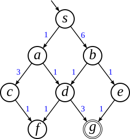
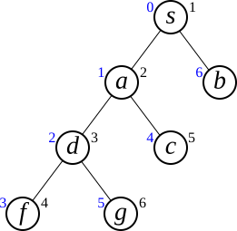

## 小テスト：分枝限定探索 の解説
状態空間を表す状態遷移図（左）と探索木（右）を示す．また，各変数の推移を下表に示す（各状態の左上の数字は $\hat g(v)$ の値を表す）．

　　　　

| #|CL                         |X      |OL                    |
|-:|:--------------------------|:------|:---------------------|
| 1|                           |       |${}^0s$               |
| 2|                           |${}^0s$|                      |
| 3|${}^0s$                    |       |${}^1a\ ^6b$          |
| 4|${}^0s$                    |${}^1a$|${}^6b$               |
| 5|${}^0s\ ^1a$               |       |${}^2d\ ^4c\ ^6b$     |
| 6|${}^0s\ ^1a$               |${}^2d$|${}^4c\ ^6b$          |
| 7|${}^0s\ ^1a\ ^2d$          |       |${}^3f\ ^4c\ ^5g\ ^6b$|
| 8|${}^0s\ ^1a\ ^2d$          |${}^3f$|${}^4c\ ^5g\ ^6b$     |
| 9|${}^0s\ ^1a\ ^2d\ ^3f$     |       |${}^4c\ ^5g\ ^6b$     |
|10|${}^0s\ ^1a\ ^2d\ ^3f$     |${}^4c$|${}^5g\ ^6b$          |
|11|${}^0s\ ^1a\ ^2d\ ^3f\ ^4c$|       |${}^5g\ ^6b$          |
|12|${}^0s\ ^1a\ ^2d\ ^3f\ ^4c$|${}^5g$|${}^6b$               |

-   #3 で OL に追加される $a$ と $b$ のコストは，それぞれ $s→a$間 と $s→b$間 のコスト（1 と 6）になる．
-   #5 で OL に追加される $c$ のコストは，$a$ のコスト (= $s→a$間 のコスト) と $a→c$間 のコストの合計（$1+3=4$）になる．
-   #5 で OL に追加される $d$ のコストは，$a$ のコスト (= $s→a$間 のコスト) と $a→d$間 のコストの合計（$1+1=2$）になる．
-   #7 で OL に追加される $f$ のコストは，$d$ のコスト (= $s→d$間 のコスト) と $d→f$間 のコストの合計（$2+1=3$）になる．
-   #7 で OL に追加される $g$ のコストは，$d$ のコスト (= $s→d$間 のコスト) と $d→g$間 のコストの合計（$2+3=5$）になる．
-   #10 で探索された $c$ の隣接ノード $f$ は，すでに CL に入っているので，(#11 で) OL には追加されない．

したがって，探索される順序は $sadfcg$ となる．